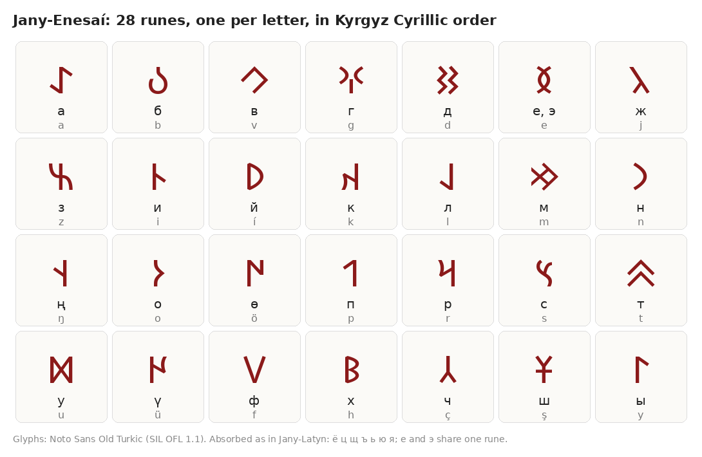
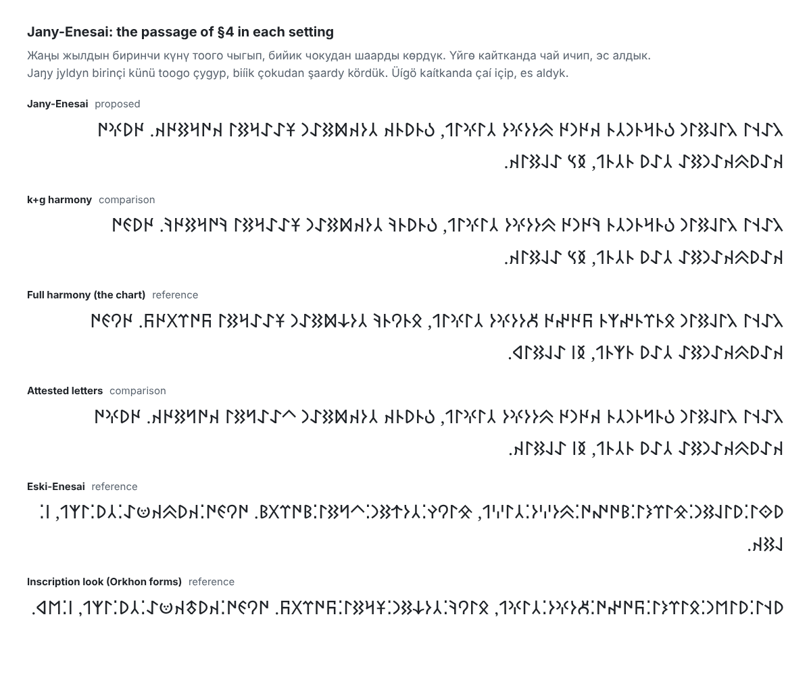
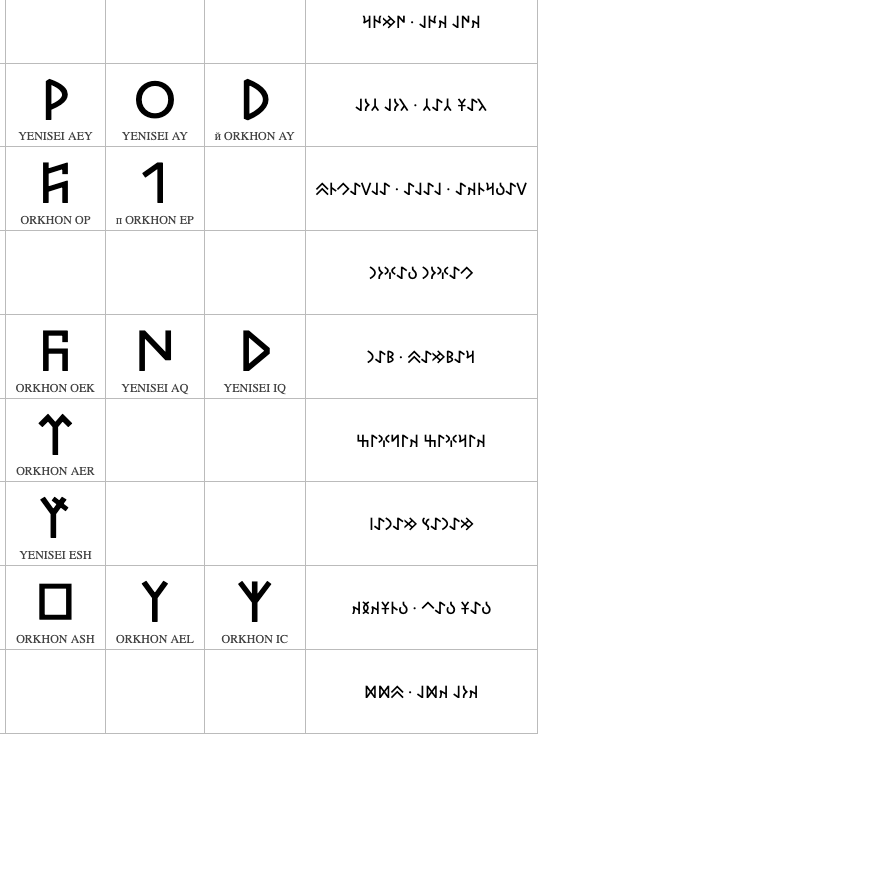

# Jany-Enesai: Modern Kyrgyz in the Old Turkic Script

**A 28-rune orthography in which every spelling is computed from Cyrillic by rule, and the Orhon-Enesai comparison settings for the Jany-Latyn testbed**

**Version:** draft 0.4, companion to *Jany-Latyn* v2026.4 (`WHITEPAPER.md`). Supersedes drafts 0.3, 0.2, and 0.1 (`ORHON-ENESAI.md`). Its rules are stated normatively in `RUNES-SPEC.md`, and its claims about the inscriptions rest on `corpus/YENISEI-KYRGYZ-CORPUS.md`.
**Status:** Draft proposal for the author's review. Implemented in the engine as `jany-latyn/runes`. Its rune spellings are regenerated by `npm run check-jany-enesai`, its treebank figures by `npm run rune-metrics` (§5.3), and its figures about the inscriptions by the corpus scripts in `corpus/scripts/`.
**Author:** Emil Madraimov · salam@qylym.com (drafted with Claude)
**Date:** October 2026
**License:** CC BY 4.0, as `WHITEPAPER.md`.

---

## Abstract

Jany-Enesai is a proposed alphabet for writing Kyrgyz in the Old Turkic script, the runes of the Orkhon and Yenisei inscriptions, which Unicode has encoded since 2009. It has 28 runes, one for each letter of Jany-Latyn. Its governing constraint is the same as Jany-Latyn's: every spelling is computed from Cyrillic by rule, without a word list, so that existing Kyrgyz text converts unattended. Because each rune writes exactly one Jany-Latyn letter, conversion back to Jany-Latyn is exact, and the round trip to Cyrillic loses exactly what Jany-Latyn loses and nothing more. On a Kyrgyz treebank, 96.3% of word tokens come back unchanged. Almost every loss is a distinction that exists only in Russian loans and Russian-style surnames. The exceptions come from three of Jany-Latyn's own reverse rules, which also lose a few native words and Kyrgyz names: iotated `е` after a vowel, `и` after a vowel, and `с` before `х`. This draft measures them and returns the questions to Jany-Latyn (§13, §27.7). The letters that exist only for Russian (`ё`, `ц`, `щ`, `ъ`, `ь`, `ю`, `я`) are absorbed as Jany-Latyn absorbs them, since no runic convention for them has ever existed. Two choices separate the alphabet from the inscriptions. First, the inscriptions write each of ten consonants with a back-vowel and a front-vowel form; Jany-Enesai writes one form, because in a script that writes every vowel the second form carries no information. Second, the inscriptions have one sign for `о` and `у`; Jany-Enesai writes `у` with 𐱈, an otherwise unused Old Turkic sign with the shape of the Old Hungarian U. The letter assignments otherwise follow a Kyrgyz community chart circulating as a short video, and every place where that chart uses a sign for something other than its Unicode value is stated. The vowel-harmony forms, the chart's complete system, and an inscription-style abbreviated spelling are offered as comparison settings, as `q` and `ğ` are in the Latin testbed. Unlike `q` and `ğ`, the harmony settings need no word list, because they record agreement with a vowel that Cyrillic writes rather than a pronunciation that only a lexicon knows.

---

## About this document

This is a design proposal for an alphabet and for a mode of an existing testbed. It is not a standard, not a reconstruction of how the Yenisei Kyrgyz wrote, and not an argument that Kyrgyz should be written in runes. Like `WHITEPAPER.md`, it argues for a set of choices, states the reasoning behind each, and names the places where the reasoning could be wrong. Unlike `WHITEPAPER.md`, it has some numbers: the engine was run over a Kyrgyz treebank (§5.3), and every runic example here is generated by the engine and checked against this text by a script, not written by hand. Statements about how readers would find the result are predictions, and §27 lists them with the tests that would settle them.

### Changes from draft 0.3

The 28 runes and every setting are unchanged. This is the first draft checked against the engine, `jany-latyn/runes`, rather than the draft prototype.

- **Every rune spelling is checked.** `npm run check-jany-enesai`, part of the engine's tests, regenerates each one: the tables, the examples in the text, the §4 passage, and the Unicode names and code points of Appendix A.
- **Every treebank figure is recomputed** by `npm run rune-metrics` (§5.3). Most are unchanged. The round trip to Cyrillic is 96.3%, not 96.4%: the engine's reverse conversion has two rules the prototype's stand-in lacked, and they add two classes of loss to §13.1, both Jany-Latyn's (§27.7). In §6, л falls in back-vowel syllables 68% of the time, not 69%. Of the 134 tokens lost to the iotated-`е` rule, 112 are surnames and 11 loans, not 113 and 10: *индеецтер* is tagged as a proper noun but is the loan *индеец*.
- **The loan-restoration list is measured** (§13.2): it restores 6 word forms of the treebank and spoils 4.
- **Eski-Enesai's shared spellings are counted** (§17).
- **A new specimen** (§4) shows the passage in all six presets, generated from the engine. It replaces `orhon-enesai-specimen.png`, which showed the draft 0.2 settings and is kept for the superseded drafts.
- **Four questions go back to Jany-Latyn** (§27.7).
- **Appendices A and B** spell the name Jany-Enesai, as the rest of the document does.

### Changes from draft 0.2

The 28 runes are unchanged. What changed comes from checking the proposal against the 21 Yenisei Kyrgyz inscriptions with text, encoded sign by sign in `corpus/YENISEI-KYRGYZ-CORPUS.md`.

- **Two inscription looks.** The draft 0.2 inscription look used Orkhon forms, none of which appears on a Yenisei Kyrgyz stone. It is kept as a reference. **Eski-Enesai** is added beside it, and the testbed shows it first: the same abbreviated spelling, written in the forms the stones themselves use most (§17, §25).
- **нт is 𐰦 in every inscription look.** The chart's 𐰧 has the shape the stones use for ŋ (§19, §21).
- **Attested letters.** р, с, and ш can each be written with the stones' form, 𐰻 𐰾 𐱀, instead of the chart's 𐰺 𐰽 𐱁 (§18). The chart's forms stay in the reference.
- **𐱈 on the stones.** It is attested once, as *baš*, and §7.2 says why that does not matter in practice.
- **§21 reports the corpus.** 20 of the 28 runes appear on the stones, and the section accounts for the other eight.
- **How the pairs look (§8.1).** The runes were set side by side in Noto Sans Old Turkic. None of the 28 changes. Three pairs, ы/и, ө/ү, and ч/ж, are close enough that the bundled font should separate them further. A new toggle writes ж with 𐰙, the chart's own front ж, and each of р, с, ш now has a toggle of its own, with с 𐰾 and ш 𐱀 marked as hard to read in running text.
- **х on the stones.** 𐰝 is attested, but there it is the syllable sign *ök* (§8).

### Changes from draft 0.1

- **One rune per letter.** The reference no longer writes back and front consonant forms. They are now comparison settings (§14).
- **`у` has its own rune.** 𐱈 replaces the shared `о`/`у` sign, so the reverse conversion no longer guesses (§7). The positional `о`/`у` table is gone.
- **Spaces and modern punctuation.** The two-dot word divider is not used (§11).
- **Russian-only letters absorbed, as in Jany-Latyn.** There is no runic precedent for them (§10).
- **Lossless conversion through the restoration list.** It comes from Jany-Latyn's optional loan-restoration list, which the runes inherit (§13).
- **Kyrgyz Cyrillic alphabetical order** for the runes (§12).
- **No Unicode-strict preset.** The reference itself now uses one sign against its Unicode value (𐱈), so the departures are tabulated instead (§8).

---

## Table of Contents

- **[Part I — Jany-Enesai in Brief](#part-i--jany-enesai-in-brief)**
  - [1. What the Alphabet Is For](#1-what-the-alphabet-is-for)
  - [2. The Alphabet at a Glance](#2-the-alphabet-at-a-glance)
  - [3. The Rule](#3-the-rule)
  - [4. In Running Text](#4-in-running-text)
  - [5. The Sources](#5-the-sources)
- **[Part II — The Case for Each Choice](#part-ii--the-case-for-each-choice)**
  - [6. One Rune per Letter](#6-one-rune-per-letter)
  - [7. A Rune of Its Own for `у`](#7-a-rune-of-its-own-for-у)
  - [8. The Chart's Signs for `ж`, `ф`, `х`, `в`, and Their Unicode Values](#8-the-charts-signs-for-ж-ф-х-в-and-their-unicode-values)
  - [9. Vowels](#9-vowels)
  - [10. The Absorbed Letters](#10-the-absorbed-letters)
  - [11. Spaces and Punctuation](#11-spaces-and-punctuation)
  - [12. Alphabetical Order and Sorting](#12-alphabetical-order-and-sorting)
  - [13. Converting Back to Cyrillic](#13-converting-back-to-cyrillic)
- **[Part III — The Orhon-Enesai Comparison Settings](#part-iii--the-orhon-enesai-comparison-settings)**
  - [14. The Settings at a Glance](#14-the-settings-at-a-glance)
  - [15. Why the Harmony Settings Need No Word List](#15-why-the-harmony-settings-need-no-word-list)
  - [16. Full Harmony and the Chart](#16-full-harmony-and-the-chart)
  - [17. The Inscription Look](#17-the-inscription-look)
  - [18. The Other Toggles](#18-the-other-toggles)
- **[Part IV — Congruity and Coherence](#part-iv--congruity-and-coherence)**
  - [19. With the Chart](#19-with-the-chart)
  - [20. With Unicode](#20-with-unicode)
  - [21. With the Inscriptions](#21-with-the-inscriptions)
  - [22. With Jany-Latyn](#22-with-jany-latyn)
- **[Part V — Specification](#part-v--specification)**
  - [23. Forward Conversion](#23-forward-conversion)
  - [24. The Harmony Settings](#24-the-harmony-settings)
  - [25. The Inscription Look](#25-the-inscription-look)
  - [26. Reverse Conversion, Display, and Input](#26-reverse-conversion-display-and-input)
- **[Part VI — Open Questions](#part-vi--open-questions)**
  - [27. Open Questions and Tests](#27-open-questions-and-tests)
- **[References](#references)**
- **[Appendices](#appendices)**
  - [Appendix A. The Complete Sign Inventory](#appendix-a-the-complete-sign-inventory)
  - [Appendix B. Worked Examples in Each Setting](#appendix-b-worked-examples-in-each-setting)

---

# Part I — Jany-Enesai in Brief

Jany-Enesai writes Kyrgyz in the runes of the Orkhon and Yenisei inscriptions with 28 runes, one for each letter of Jany-Latyn, so any Cyrillic Kyrgyz text converts to it automatically and comes back again. *Кыргыз* is 𐰴𐰃𐰺𐰍𐰃𐰕: one rune each for к, ы, р, г, ы, з, read from right to left. *Кол* (hand) and *кул* (slave), which the inscriptions would write alike, are 𐰴𐰆𐰞 and 𐰴𐱈𐰞.

The name follows Jany-Latyn's: *Jany-Enesai* is the plain form of *Jaŋy Enesaí*, "New Yenisei", in runes 𐰳𐰀𐰭𐰃 𐰅𐰣𐰅𐰽𐰀𐰖. *Orhon-Enesai* (*Орхон-Энесай*, the Kyrgyz name of the script) is the name of the testbed mode, which offers Jany-Enesai together with its comparison settings.

## 1. What the Alphabet Is For

Jany-Enesai has the same two intended uses as Jany-Latyn, at a smaller scale:

- **A transliteration** of text that already exists in Cyrillic, for display, design, signage, and heritage and teaching material, made unattended and reversible.
- **A way to write Kyrgyz directly in runes**, for anyone who wants to, with one key per letter and nothing to decide while typing.

Where the two conflict, the transliteration use wins here too, which is why the alphabet has no letter that cannot be computed from Cyrillic (§3).

It is not a reconstruction. The Yenisei inscriptions were written in a language a millennium older than modern Kyrgyz, with conventions this alphabet does not follow: chiefly the omission of most vowels, and the back and front consonant forms that stood in for them (§6, §21). It is also not a claim about how Old Kyrgyz sounded. What it offers is narrower: a documented, reproducible way to write modern Kyrgyz in these letters, with every choice that departs from the inscriptions or from Unicode made visible, and every alternative available as a setting.

## 2. The Alphabet at a Glance

The same 28 runes as text, in Kyrgyz Cyrillic order (§12). The chart row is the row of the video chart (§5) that gives the sign:

| # | Cyrillic | Jany-Latyn | Rune | Unicode name | Chart row |
| ---: | :--- | :---: | :---: | :--- | :---: |
| 1 | а | a | 𐰀 | ORKHON A | 1 |
| 2 | б | b | 𐰉 | ORKHON AB | 3 |
| 3 | в | v | 𐰊 | YENISEI AB | 43 |
| 4 | г | g | 𐰍 | ORKHON AG | 13 |
| 5 | д | d | 𐰑 | ORKHON AD | 9 |
| 6 | е, э | e | 𐰅 | YENISEI E | 11 |
| 7 | ж | j | 𐰳 | YENISEI EC | 5 |
| 8 | з | z | 𐰕 | YENISEI EZ | 45 |
| 9 | и | i | 𐰄 | YENISEI I | 16 |
| 10 | й | í | 𐰖 | ORKHON AY | 17 |
| 11 | к | k | 𐰴 | ORKHON AQ | 19 |
| 12 | л | l | 𐰞 | ORKHON AL | 24 |
| 13 | м | m | 𐰢 | ORKHON EM | 26 |
| 14 | н | n | 𐰣 | ORKHON AN | 27 |
| 15 | ң | ŋ | 𐰭 | ORKHON ENG | 29 |
| 16 | о | o | 𐰆 | ORKHON O | 30 |
| 17 | ө | ö | 𐰇 | ORKHON OE | 31 |
| 18 | п | p | 𐰯 | ORKHON EP | 32 |
| 19 | р | r | 𐰺 | ORKHON AR | 33 |
| 20 | с | s | 𐰽 | ORKHON AS | 35 |
| 21 | т | t | 𐱄 | YENISEI AT | 38 |
| 22 | у | u | 𐱈 | ORKHON BASH | 50 |
| 23 | ү | ü | 𐰈 | YENISEI OE | 42 |
| 24 | ф | f | 𐰟 | YENISEI AL | 12 |
| 25 | х | h | 𐰝 | YENISEI OEK | 15 |
| 26 | ч | ç | 𐰲 | ORKHON EC | 7 |
| 27 | ш | ş | 𐱁 | ORKHON ESH | 37 |
| 28 | ы | y | 𐰃 | ORKHON I | 44 |

The 36 letters of Kyrgyz Cyrillic minus the seven that exist only for Russian, with `е` and `э` sharing one rune, leave exactly these 28. That is Jany-Latyn's alphabet as well, letter for letter:

| Cyrillic | Treatment | As in Jany-Latyn | Example |
| :--- | :--- | :--- | :--- |
| е, э | One rune, 𐰅 | `e`, with `íe` for iotated `е` | *эл* 𐰅𐰞, *Европа* 𐰖𐰅𐰊𐰺𐰆𐰯𐰀 |
| ё, ю, я | Glide 𐰖 + vowel | `ío`, `íu`, `ía` | *коён* 𐰴𐰆𐰖𐰆𐰣, *аюу* 𐰀𐰖𐱈𐱈 |
| ц | т + с | `ts` | *цирк* 𐱄𐰽𐰄𐰺𐰴 |
| щ | ш | `ş` | *борщ* 𐰉𐰆𐰺𐱁 |
| ъ, ь | Absorbed into the glide, or dropped | absorbed, dropped | *объект* 𐰆𐰉𐰖𐰅𐰴𐱄, *семья* 𐰽𐰅𐰢𐰖𐰀 |

Long vowels are doubled, as in Cyrillic and Jany-Latyn: *тоо* (mountain) 𐱄𐰆𐰆, *туу* (flag) 𐱄𐱈𐱈.

## 3. The Rule

Conversion runs in two stages:

1. **Cyrillic → Jany-Latyn full form.** This is the existing engine with every testbed option at its Jany-Latyn default, whatever the reader has selected for display.
2. **Jany-Latyn → runes.** Each letter is replaced by its rune from the table in §2. No letter needs context.

Going through Jany-Latyn rather than straight from Cyrillic is the coherence argument in its simplest form. Every decision Jany-Latyn makes about the loan layer carries over unchanged, and there is no second set of rules to keep in step with the first. The canonical input also isolates the runes from the Latin testbed's toggles: a reader viewing `q` mode or the dotless `ı` sees the same runes as one viewing Jany-Latyn.

Because the second stage is a letter-for-letter substitution, the runes and Jany-Latyn are two spellings of one alphabet. Every property Jany-Latyn has as a sequence of letters, the runes have too: the round trip, the losses and where they fall (§13), and the word list that can restore them.

## 4. In Running Text

> **Cyrillic.** Жаңы жылдын биринчи күнү тоого чыгып, бийик чокудан шаарды көрдүк. Үйгө кайтканда чай ичип, эс алдык.
>
> **Jany-Latyn.** Jaŋy jyldyn birinçi künü toogo çygyp, biíik çokudan şaardy kördük. Üígö kaítkanda çaí içip, es aldyk.
>
> **Jany-Enesai** (read right to left, top to bottom):
>
> 𐰳𐰀𐰭𐰃 𐰳𐰃𐰞𐰑𐰃𐰣 𐰉𐰄𐰺𐰄𐰣𐰲𐰄 𐰴𐰈𐰣𐰈 𐱄𐰆𐰆𐰍𐰆 𐰲𐰃𐰍𐰃𐰯, 𐰉𐰄𐰖𐰄𐰴 𐰲𐰆𐰴𐱈𐰑𐰀𐰣 𐱁𐰀𐰀𐰺𐰑𐰃 𐰴𐰇𐰺𐰑𐰈𐰴. 𐰈𐰖𐰍𐰇 𐰴𐰀𐰖𐱄𐰴𐰀𐰣𐰑𐰀 𐰲𐰀𐰖 𐰄𐰲𐰄𐰯, 𐰅𐰽 𐰀𐰞𐰑𐰃𐰴.

Whether the runic line displays correctly depends on the reader's fonts and on how the page handles right-to-left text (§26). The specimen below shows the same passage in the bundled font and the right direction, in Jany-Enesai and in each preset of the testbed. `packages/engine/scripts/make-specimen.ts` regenerates it.

## 5. The Sources

### 5.1 What each source decides

| Source | What it decides |
| :--- | :--- |
| **The chart** [[V1]](#refV1): *Байыркы кыргыз алфавити* ("the ancient Kyrgyz alphabet"), 45 numbered signs and 5 "double consonants", each labelled in Kyrgyz Arabic script | Which sign stands for which Kyrgyz sound |
| **The second chart** in the same video [[V1]](#refV1): Kyrgyz Arabic, Cyrillic, and a CTA-style Latin side by side | How the first chart's Arabic labels read in Cyrillic |
| **Unicode**, Old Turkic block [[U1]](#refU1)[[U2]](#refU2), and its encoding proposal [[U3]](#refU3) | Which codepoint each drawn sign is, the direction, and what software does with the characters by default |
| **Wikipedia**, "Old Turkic script" [[W1]](#refW1) | Transliteration values and the back/front pairing of the consonants, as a cross-check |
| **Jany-Latyn**, `WHITEPAPER.md` [[JL]](#refJL) | The principles, the letters, and every decision about the loan layer |
| **The Yenisei Kyrgyz inscriptions**, as encoded in `corpus/YENISEI-KYRGYZ-CORPUS.md` from *A Database of Turkic Runiform Inscriptions* [[C2]](#refC2) | Which forms the stones use, for Eski-Enesai and the Attested letters setting (§17, §18), and every claim about the inscriptions (§21) |

The chart is a community artifact of unknown authorship. Its Arabic labels are in the Arabic-based Kyrgyz orthography used in Xinjiang, which writes ы, и, ө, and ү with distinct letters (ى, ئ, ۅ, ۉ), so its vowel distinctions can be read off without guessing. It decides the letter assignments because it is what Kyrgyz readers are already being shown. Where it conflicts with Unicode, §8 and §20 say so.

### 5.2 What the sources do not contain

No source gives runes for the letters that exist only for Russian, and none could have. Kasym Tynystanov's alphabet reforms were in Arabic script (1924) and Latin script (1925–1928), and none adapted the runes to modern Kyrgyz [[T1]](#refT1). The inscriptions have no letters for `ф`, `х`, or `в`, which came into Kyrgyz with later loans, so even the chart's signs for them are modern assignments of existing signs, not attested values (§8). Jany-Enesai therefore invents no signs: it takes the chart's, adds one for `у` from the same Unicode block (§7), and absorbs the rest as Jany-Latyn does (§10).

### 5.3 How the reading and the figures were produced

The video is 9.75 seconds long and shows only the two charts. Frames were extracted, and each of the 50 drawn signs was matched against the glyphs of Noto Sans Old Turkic [[F1]](#refF1), with the Wikipedia transliterations as a cross-check. Appendix A gives the result sign by sign. Three readings are less certain than the rest: row 5 (`λ`, read as U+10C33), row 43 (an angle with a long right stroke, read as U+10C0A rather than the plain angle U+10C40), and row 48 (a single zigzag, read as U+10C29).

The figures come from the engine itself, `jany-latyn/runes`, run by `npm run rune-metrics` over release r2.18 of UD Kyrgyz-KTMU [[C1]](#refC1). The treebank is not part of the repository, since its license, CC BY-SA 4.0, is not the engine's; `packages/engine/scripts/fetch-ud-kyrgyz.sh` clones that release into a git-ignored directory. A word is a run of Cyrillic letters in a sentence's text line, with hyphenated parts joined, and word types are counted lowercased. That gives 2,520 sentences of news and fiction, 19,587 Cyrillic word tokens, and 6,269 word types; the release has 2,530 sentences, ten of them without a text line. `npm run rune-metrics -- --check` fails if this document states any of the figures differently. Draft 0.3's figures came from a TypeScript prototype. Where the engine differs from it (§6, §13), this draft gives the engine's.

---

# Part II — The Case for Each Choice

## 6. One Rune per Letter

The inscriptions write ten consonants, б г д й к л н р с т, with two signs each, one for syllables with back vowels (а ы о у) and one for syllables with front vowels (э и ө ү). The encoding proposal classes the consonants as back-vowel, front-vowel, and neutral [[U3]](#refU3). Jany-Enesai writes each of them, and `ж`, with one rune.

The reason is Jany-Latyn's Principle 3: no separate letters for what is predictable. In the inscriptions the second set of signs did real work, because the vowels were mostly left unwritten and the consonant series was how a reader knew which vowels to supply (§21). Jany-Enesai writes every vowel, so the series of each consonant can be computed from the vowel beside it, which is exactly how the comparison settings compute it (§15). A letter that can be computed from its neighbor carries no information, and writing it costs the reader a second shape to learn, the writer a decision at every consonant, and the keyboard a layer.

The rune kept for each of these letters is its back form, which is also the commoner one in running text. In the treebank, between 62% (к) and 79% (ж, й) of each letter's occurrences fall in back-vowel syllables, and two-thirds of all their occurrences together. Wherever they do, the reference rune is the inscriptions' own back form.

| | б | г | д | ж | й | к | л | н | р | с | т |
| :--- | ---: | ---: | ---: | ---: | ---: | ---: | ---: | ---: | ---: | ---: | ---: |
| In back-vowel syllables | 63% | 69% | 71% | 79% | 79% | 62% | 68% | 65% | 66% | 68% | 63% |

The cost falls on readers who already know the inscriptions. They will see the back `к` in *көл*, 𐰴𐰇𐰞, where the inscriptions would write the front sign, 𐰜𐰇𐰠. That is the comparison the k+g and full harmony settings exist to make on real text (§14). Whether readers who know the chart accept the reference spelling is the first open question (§27.1).

## 7. A Rune of Its Own for `у`

### 7.1 Why `о` and `у` need two runes

The inscriptions have one sign, 𐰆, for `o` and `u`, and the chart keeps it for both. In Kyrgyz the merger falls in native vocabulary. *Кол* and *кул*, *тоо* and *туу*, *он* and *ун*, and *ошол* and *ушул* would all be spelled alike. Converting back would mean guessing at every 𐰆, and in draft 0.1 the best positional rule managed only 58% of the words that contain one. This is the one merger the native-priority rule of `WHITEPAPER.md` §18.1 exists to forbid: there it is always a loanword distinction that is allowed to be lost, while here both members are native.

### 7.2 The candidates

Unicode has no second `O` among its Orkhon and Yenisei forms, so `у` needs a sign from somewhere else. Four places were tried:

| Candidate | What happens | Verdict |
| :--- | :--- | :--- |
| **𐱈 U+10C48 `ORKHON BASH`** | An Old Turkic sign that no Kyrgyz letter needs, drawn as a bowtie ⋈, the same shape as the Old Hungarian (rovás) U. Renders in every Old Turkic font. | **Chosen** |
| **𐰆 + U+0307**, a combining dot | Unicode-honest, and the closest analogue of Jany-Latyn's `í`. But no Old Turkic font contains the mark: Chromium draws a missing-glyph box above every `у` unless the page supplies a font that has it. | A comparison toggle (§18) |
| **𐳪 U+10CEA**, the Old Hungarian small U | A genuine runiform U, also written right to left. But it brings a second script into the middle of words, needs a second font, and has a capital form (𐲪) that case conversion would produce. | A comparison toggle (§18) |
| **ᚢ U+16A2**, the Germanic U rune | A left-to-right letter. Inside a right-to-left word it is displayed correctly only in a right-to-left paragraph. In left-to-right text, such as a label, a chat message, or this document, it breaks the word apart: 𐰸ᚢ𐰞𐰑𐰀𐰺 displays in the wrong order. | Rejected |

𐱈 costs one thing: Unicode gives it another value, the syllable *baš*. The chart's footer uses the same shape for a ligature it labels рт, which Jany-Enesai does not need (§19). On the Yenisei Kyrgyz stones the sign occurs once, read *baš*, in a stretch of Uyuk Arzhan that the database marks only partly legible. That reading cannot reach a Jany-Enesai text by accident: the testbed's detector tells modern spelling from the stones' and sends only the stones to the inscription reader (`RUNES-SPEC.md` §9). In return, `у` is a native sign of the same script, has no case, needs no second font, and survives copying into any environment that can show Old Turkic at all.

### 7.3 What it changes

The round trip from runes to Jany-Latyn is now exact. In the engine, all 2,520 treebank sentences convert to runes and back to the identical Jany-Latyn, in Jany-Enesai and in every other reversible setting. No two words in the treebank share a rune spelling unless they already share a Jany-Latyn one, as two pairs of spelling variants do (*тельман* and *телман*, *келем* and *кэлем*). *Кол* 𐰴𐰆𐰞 and *кул* 𐰴𐱈𐰞, *тоо* 𐱄𐰆𐰆 and *туу* 𐱄𐱈𐱈, and *болуу* 𐰉𐰆𐰞𐱈𐱈 all come back as they went in. 𐱈 is wider than most runes, and whether the bundled font should draw a narrower variant of it is left to the font (§27.3).

## 8. The Chart's Signs for `ж`, `ф`, `х`, `в`, and Their Unicode Values

Unicode encodes the Orkhon and Yenisei forms of a letter as separate characters without giving them separate values. The names indicate the typical area of use, and "do not imply more than that" [[U3]](#refU3). Against that background, nine of the 28 Jany-Enesai runes depart from their Unicode value, in seven rows:

| Letter | Rune | Unicode name | Unicode's value | Kind of departure | Source |
| :--- | :---: | :--- | :--- | :--- | :--- |
| ы / и | 𐰃 / 𐰄 | `ORKHON I` / `YENISEI I` | Two forms of one `ı`/`i` | Variant pressed into service | Chart |
| ө / ү | 𐰇 / 𐰈 | `ORKHON OE` / `YENISEI OE` | Two forms of one `ö`/`ü` | Variant pressed into service | Chart |
| ж | 𐰳 | `YENISEI EC` | `č`, the Yenisei form of 𐰲 | Repurposed | Chart |
| ф | 𐰟 | `YENISEI AL` | Back `l`, the Yenisei form of 𐰞 | Repurposed | Chart |
| х | 𐰝 | `YENISEI OEK` | Front `k` by `ö`/`ü` | Repurposed | Chart |
| в | 𐰊 | `YENISEI AB` | Back `b`, the Yenisei form of 𐰉 | Repurposed, mildly: still a form of `b`, the nearest native consonant | Chart |
| у | 𐱈 | `ORKHON BASH` | The syllable *baš* | Repurposed | This proposal (§7) |

The other 19 runes write the letter their names give them. In the reference they write it in front-vowel syllables too, where the inscriptions would use the front form (§6). That Unicode encoded the variants as separate characters is what makes the chart's vowel distinctions workable in plain text at all: had the Orkhon and Yenisei `I` been one character with two glyphs, no file could tell *кыз* from *киз*.

The cost is in what software assumes. Default collation, which is what a database, a spreadsheet, or a browser's `Intl.Collator` uses unless told otherwise, treats each Orkhon/Yenisei pair as one letter. Under ICU 77.1 (Unicode 16) and ICU 78.3 (Unicode 17) at base strength, five pairs of Jany-Enesai runes compare equal: и with ы, ү with ө, ж with ч, ф with л, and в with б. 𐱈 and 𐰝 collide with nothing in the alphabet. In practice:

- **Rendering:** no effect. Every font with the block draws every character.
- **Sorting:** the default order files и with ы, and ж with ч. The engine needs its own comparison, as Jany-Latyn already does (§12).
- **Search:** a matcher that ignores accents at base strength would find ч when asked for ж. Whether browsers' find-in-page behaves this way for Old Turkic is a prediction, not checked.
- **Interoperability:** a tool that reads the characters by their Unicode values, such as a scholarly transliterator, would read *жол* 𐰳𐰆𐰞 as *čol*.

In the treebank, ж occurs in 10.3% of word tokens, в in 2.7%, ф in 1.3%, and х in 0.3%. The vowel variants are in most words, since ы and и are the commonest vowels of the language.

One repurposing is invisible in the count of signs the stones attest. 𐰝 does occur on the Yenisei Kyrgyz stones, on seven of them, but as the syllable sign *ök*, к beside ө or ү. Under full harmony, Jany-Enesai writes к beside ө or ү with 𐰜, the Orkhon form of that same sign, so two forms of one Unicode letter end up writing two different letters, к and х. The one unused alternative of the k family, 𐰵 `YENISEI AQ`, is drawn as an N, the shape of ө 𐰇, which would be worse. 𐰝 stays, since х is rare and the chart uses it.

### 8.1 How the pairs look

Five of the chart's assignments take two forms of one Unicode letter and use them as two letters: ы/и, ө/ү, ч/ж, л/ф, and б/в. Set side by side in Noto Sans Old Turkic, the font the testbed bundles and macOS ships, they fall into two groups:

- **Distinct:** л 𐰞 and ф 𐰟 (a hook and a V), б 𐰉 and в 𐰊 (a loop and an angle).
- **Close:** ы 𐰃 and и 𐰄 differ only in where the side stroke meets the stem, at the top or halfway down. ө 𐰇 and ү 𐰈 differ by one extra stroke. ч 𐰲 (⅄) and ж 𐰳 (λ) differ by one foot, and this is the weakest pair of the alphabet.

The block has no better unused sign for any of them, and the chart is what readers are shown, so the runes stay. The remedy belongs to the font: the bundled font should exaggerate the stroke that tells each close pair apart, without changing a code point. For ж there is also a toggle (§18): 𐰙, the form the chart itself gives ж beside front vowels, written in every syllable. Its Unicode value is a *y*, which is also the history of the letter (Old Turkic *yol* is Kyrgyz *жол*, and the stones write such words with *y*). It looks nothing like ч, though it is somewhat close to й 𐰖 (a P against a D).

The stones' own forms for р, с, ш fare differently in running text. 𐰻 for р reads well. 𐰾 for с is a single vertical stroke, easily taken for ы 𐰃 or for punctuation, and 𐱀 for ш is a single caret, half of т 𐱄. They work on the stones, whose set of signs is different, and Eski-Enesai keeps them for that reason. In a script that writes every vowel they are hard to read, which is a reason to keep the chart's 𐰽 and 𐱁 whatever the survey of §27.4 finds.

## 9. Vowels

The eight Kyrgyz vowels have seven runes, since `е` and `э` share 𐰅 as they share Jany-Latyn's `e`. Jany-Latyn's positional rules decide which Cyrillic letter comes back (`WHITEPAPER.md` §15.1, Appendix A).

The inscriptions write one sign for `ı` and `i` and one for `ö` and `ü`, and leave the consonants to tell them apart. Jany-Enesai has no consonant series to do that (§6), so the vowels have to: it follows the chart in writing ы and и with the Orkhon and Yenisei `I`, and ө and ү with the Orkhon and Yenisei `OE` (§8). With 𐱈 for у, every vowel has a rune of its own.

The chart's ə (row 2, 𐰂 `YENISEI AE`) writes a front low vowel that Kyrgyz Cyrillic does not write. Jany-Enesai uses it only for the compose-mode `ä` of `WHITEPAPER.md` §20, so a person writing southern *äkä* in Latin gets it in runes. It is not one of the 28.

## 10. The Absorbed Letters

`ё`, `ц`, `щ`, `ъ`, `ь`, `ю`, and `я` have no runes, for the reason §5.2 gives: none exist, and inventing them would put signs into the script that no reader of it could recognize. They are absorbed exactly as Jany-Latyn absorbs them (`WHITEPAPER.md` §16, §18.1): `ц` as т+с, `щ` as ш, the iotated vowels as the glide 𐰖 followed by the vowel, and the hard and soft signs into the glide or dropped. The losses that follow are Jany-Latyn's own, and §13 measures them.

## 11. Spaces and Punctuation

Words are separated by spaces and punctuated with the marks of modern Kyrgyz: periods, commas, colons, dashes, quotation marks. The inscriptions' two-dot divider ⁚ (U+205A) was tried and set aside. It looks like a colon, and next to modern punctuation it reads as one. A text that already uses colons, periods, and dashes as Kyrgyz does needs no second set of word-level marks.

## 12. Alphabetical Order and Sorting

The alphabet's order is the order of Kyrgyz Cyrillic, with the absorbed letters left out and 𐰅 in the place of `е`:

𐰀 𐰉 𐰊 𐰍 𐰑 𐰅 𐰳 𐰕 𐰄 𐰖 𐰴 𐰞 𐰢 𐰣 𐰭 𐰆 𐰇 𐰯 𐰺 𐰽 𐱄 𐱈 𐰈 𐰟 𐰝 𐰲 𐱁 𐰃

A list of names in runes therefore sorts as the same list does in Cyrillic, except where `э` and an absorbed letter would have separated two words. This is the same principle as `WHITEPAPER.md` §17, applied to a different reader: a Kyrgyz reader learns the runes from Cyrillic, so the runes take the order that reader already knows.

Sorting has to be done by the engine's own comparison, a rank table like Jany-Latyn's `compare` (`WHITEPAPER.md` Appendix C), because default collation files the variant pairs together (§8) and `Intl.Collator` takes no tailoring. The harmony settings' extra forms sort with the letter they write, at a secondary level.

## 13. Converting Back to Cyrillic

### 13.1 What is exact and what is lost

Conversion from runes to Jany-Latyn is exact: each rune writes one letter. Conversion from Jany-Latyn to Cyrillic is the engine's existing reverse conversion, with its native-priority rule (`WHITEPAPER.md` §18.1). The round trip from Cyrillic to runes and back is therefore exactly as good as Jany-Latyn's, and fails in the same places.

Measured with the engine's reverse conversion, without the loan-restoration list: 96.3% of the treebank's 19,587 word tokens come back unchanged. The other 3.7% are 354 distinct word forms of 233 lemmas, and they fall into eight classes:

| Cause | Tokens | Examples | Who loses |
| :--- | ---: | :--- | :--- |
| `ц` | 313 | *инвестиция*, *продукция*, *милиция* | Russian loans |
| Iotated `е` after a vowel | 133 | *Ташиев*, *Төрөбаев*; *каерде*, *аерде*, *тиешелүү*; *поезд* | Russian-style surnames (112), a few native words, loans |
| `ъ`, `ь` | 100 | *асфальт*, *объект*, *рубль* | Russian loans |
| `э` after a consonant | 65 | *мэрия*, *мэр*, *ГЭС* | Loans and abbreviations |
| `ё` against `йо` | 59 | *район* comes back as *раён* | A Russian loan |
| `э` after a vowel | 36 | *аэропорт* | Russian loans |
| `и` after a vowel | 23 | *украина*, *израилдин*; *шаирбек*, *исмаилова*; *иим* | Loans, Kyrgyz names, an abbreviation |
| `с` before `х` | 1 | *схеманы* | A Russian loan |

Each token is counted once, under the first cause in the table that applies to it.

Five of the eight fall entirely in the loan layer, where Jany-Latyn's native-priority rule expects losses. The other three reach beyond it, and they are Jany-Latyn's rather than the runes'. The first is iotated `е` after a vowel. `WHITEPAPER.md` §18.1 states it as a loan loss (*proíekt → пройект*), but Kyrgyz Cyrillic also writes iotated `е` after a vowel as plain `е` in native words and in Kyrgyz surnames (*каерде*, *тиешелүү*, *Ташиев*). Jany-Latyn writes every such `е` as `íe`, and the reverse rule sends post-vocalic `íe` back as `йе`, for the sake of forms such as *кийет*. In this treebank, the rule restores no token, since no word in it spells `й` + `е` after a vowel. It loses every one of the 134 tokens that spell plain `е`: 112 surnames, 11 Russian loans, and 11 native or long-nativized words such as *каерде*, *аерде*, *тиешелүү*, and *ниет*. The Apertium Kyrgyz lexicon [[A1]](#refA1) points the same way: 24 of its stems have a vowel followed by `е`, and 2 have a vowel followed by `йе`. The forms the rule protects are inflected ones (*кий-* + *-ет*), which a lexicon of stems does not list and a news treebank barely contains. So the question needs a corpus with more verbs before it can be settled. It is a question for Jany-Latyn, and whatever Jany-Latyn decides carries over to the runes unchanged.

The other two are new in this draft: the prototype's stand-in for the reverse conversion did not have them, and the engine does. The engine reads `i` after a vowel as `й`, for text that writes the glide the older way, as plain `i`; Jany-Latyn itself writes the glide `í`, so in Jany-Latyn text the rule only loses, and *украина* comes back as *украйна* and *Шаирбек* as *Шайрбек*. And it reads `sh` as the legacy digraph for `ш`, so *схеманы*, which Jany-Latyn writes *shemany*, comes back as *шеманы*. Both are questions for Jany-Latyn (§27.7), and the runes inherit whatever it decides.

### 13.2 Lossless: the restoration list

Jany-Latyn already provides the remedy for the loan layer: an optional, documented loan-restoration list consulted only on the reverse side (`WHITEPAPER.md` §18.2). Because Jany-Enesai maps letter for letter onto Jany-Latyn, the same list restores the same words from runes, with no change to the rune stage. The lossless setting of the testbed is Jany-Enesai with that list switched on. On this corpus the list would need about 230 lemmas, or far fewer if the iotated-`е` question of §13.1 is settled by rule, since the Russian-style surnames alone account for 112 of the losses and are an open class that no list can cover. As it stands, the list restores 6 word forms and spoils 4. It restores *объект* and two of its case forms, *июль*, *компьютер*, and *поезд*, and it gives *апрелге*, *июлга*, *июлда*, and *июлдан*, Kyrgyz case forms of *апрель* and *июль*, the soft sign that Kyrgyz spelling drops before a Kyrgyz suffix (§27.7).

---

# Part III — The Orhon-Enesai Comparison Settings

## 14. The Settings at a Glance

Every contested choice in Jany-Enesai is a setting in the Orhon-Enesai mode, in the same spirit as the Latin testbed (`WHITEPAPER.md` §7): the toggles exist so that the alternative can be read on real text rather than described. Four steps form a ladder, each further from the reference, and the last step comes in two forms. The phrase *аңкыгый жигит* ("a gawky young man"), which `WHITEPAPER.md` §6 uses for the same purpose, shows each step:

| Setting | Changes from Jany-Enesai | *аңкыгый жигит* | Reversible? | Needs a word list? |
| :--- | :--- | :--- | :---: | :---: |
| **Jany-Enesai** | — | **𐰀𐰭𐰴𐰃𐰍𐰃𐰖 𐰳𐰄𐰍𐰄𐱄** | Yes | No |
| k+g harmony | к and г take back or front forms by the vowel of their syllable | 𐰀𐰭𐰴𐰃𐰍𐰃𐰖 𐰳𐰄𐰏𐰄𐱄 | Yes | No |
| Full harmony | All ten paired consonants and ж, plus the vowel-bound signs 𐰸 𐰶 𐰜 𐱇 𐰱: the chart's whole system | 𐰀𐰭𐰶𐰃𐰍𐰃𐰖 𐰙𐰄𐰏𐰄𐱅 | Yes | No |
| Eski-Enesai | Full harmony, with the inscriptions' vowel letters, their abbreviated spelling, and the forms the Yenisei Kyrgyz stones use most | 𐰬𐰴𐰎𐰖 𐰘𐰃𐰏𐱅 | No | No |
| Inscription look (Orkhon forms) | The same, in the forms of the Orkhon monuments | 𐰭𐰶𐰍𐰖 𐰘𐰃𐰏𐱅 | No | No |
| Lossless | Jany-Enesai spelling; the reverse conversion consults the loan-restoration list | 𐰀𐰭𐰴𐰃𐰍𐰃𐰖 𐰳𐰄𐰍𐰄𐱄 | Yes, to Cyrillic | Yes, on the reverse side only |

Runes read right to left; in the multi-word cells, the first word is the rightmost. k+g harmony is the runic counterpart of the Latin testbed's `q`+`ğ` setting, and it changes 22.9% of the treebank's word types. Full harmony changes 62.8%. Neither creates a shared spelling: under the reference and both harmony settings, two words in the treebank share a rune spelling only where they already share a Jany-Latyn one, so all three convert back exactly. The front forms the harmony settings add are these:

| Letter | Reference rune | Unicode name | Front form | Unicode name | In k+g harmony | Vowel-bound signs (full harmony only) |
| :--- | :---: | :--- | :---: | :--- | :---: | :--- |
| б (b) | 𐰉 | ORKHON AB | 𐰋 | ORKHON AEB | no | — |
| г (g) | 𐰍 | ORKHON AG | 𐰏 | ORKHON AEG | yes | — |
| д (d) | 𐰑 | ORKHON AD | 𐰓 | ORKHON AED | no | — |
| ж (j) | 𐰳 | YENISEI EC | 𐰙 | YENISEI AEY | no | — |
| й (í) | 𐰖 | ORKHON AY | 𐰘 | ORKHON AEY | no | — |
| к (k) | 𐰴 | ORKHON AQ | 𐰚 | ORKHON AEK | yes | by о/у 𐰸, by ы 𐰶, by ө/ү 𐰜 |
| л (l) | 𐰞 | ORKHON AL | 𐰠 | ORKHON AEL | no | — |
| н (n) | 𐰣 | ORKHON AN | 𐰤 | ORKHON AEN | no | — |
| р (r) | 𐰺 | ORKHON AR | 𐰼 | ORKHON AER | no | — |
| с (s) | 𐰽 | ORKHON AS | 𐰾 | ORKHON AES | no | — |
| т (t) | 𐱄 | YENISEI AT | 𐱅 | ORKHON AET | no | by о/у 𐱇 |
| ч (ç) | 𐰲 | ORKHON EC | — |  | no | by и 𐰱 |

## 15. Why the Harmony Settings Need No Word List

Jany-Latyn declines `q` and `ğ` because they are *splits*: one Cyrillic letter becomes two Latin letters depending on the word, and Kyrgyz Cyrillic does not record which words are borrowed (`WHITEPAPER.md` §3, §8). A rule that writes *кар* as *qar* also writes *космос* as *qosmos*. The harmony settings split к and г the same way, and the rest of the paired consonants under full harmony, yet they apply the split to every word with no list at all. The two positions are consistent, because the two splits are conditioned on different things.

A Latin `q` asserts a pronunciation, the uvular [q], and the pronunciation of к depends on the word's history: loans keep velar [k] beside back vowels. A runic back-series consonant asserts something else: agreement with the vowel beside it, which is how the script itself classes its consonants [[U3]](#refU3). The vowel beside each consonant is written in the Cyrillic, in loans as in native words, so agreement can always be computed. Under k+g harmony *космос* is 𐰴𐰆𐰽𐰢𐰆𐰽, with the back-series к that agreement with о requires, and the spelling claims nothing about whether the speaker's к is uvular.

The cost a lexicon would have paid does not disappear; it moves to the reader. A reader trained on the inscriptions reads the back к as [q] and has to know, as a reader of Cyrillic does, that *космос* is a loan. A pronunciation-faithful variant, back к only where the speaker says [q], would need the same word list as `q`, and is not offered. Agreement is what the source text can compute.

The governing vowel is found the way a Kyrgyz word is syllabified. A medial syllable has exactly one consonant before its vowel (V.CV, VC.CV, VCC.CV), so a consonant directly before a vowel agrees with that vowel, and any other consonant agrees with the vowel before it. Consonants at the start of a word, including the clusters of loans such as *спорт*, take the first vowel; consonants at the end take the last. The rule works per syllable rather than per word, which matters for the 21% of word types in the treebank that contain both back and front vowels. *Темиржол* (railway) under full harmony is 𐱅𐰅𐰢𐰄𐰼𐰳𐰆𐰞, front forms in *темир* and back forms in *жол*.

## 16. Full Harmony and the Chart

The chart writes its own title in runes, and the full harmony setting reproduces all three words exactly:

| Title word | The chart's rune line | Full harmony | Jany-Enesai |
| :--- | :--- | :--- | :--- |
| Байыркы | 𐰉𐰀𐰖𐰃𐰺𐰶𐰃 | 𐰉𐰀𐰖𐰃𐰺𐰶𐰃 | 𐰉𐰀𐰖𐰃𐰺𐰴𐰃 |
| кыргыз | 𐰶𐰃𐰺𐰍𐰃𐰕 | 𐰶𐰃𐰺𐰍𐰃𐰕 | 𐰴𐰃𐰺𐰍𐰃𐰕 |
| алфавити | 𐰀𐰞𐰟𐰀𐰊𐰄𐱅𐰄 | 𐰀𐰞𐰟𐰀𐰊𐰄𐱅𐰄 | 𐰀𐰞𐰟𐰀𐰊𐰄𐱄𐰄 |

The match shows how the chart's author used the signs. Every vowel is written, including the `ы` after the к-by-ы sign 𐰶. Harmony is decided per syllable: *алфавити* has the back л in its first syllable and the front т in its last. And the runes follow the Cyrillic spelling *алфавити* even where the Arabic line above them writes `ы` (الفاۋىتى). Jany-Enesai differs from the title in three signs, all of them harmony forms.

## 17. The Inscription Look

The inscription look imitates the appearance of the inscriptions as far as a rule allows. It applies full harmony, writes one vowel sign per pair as the inscriptions do, writes ж with the y-runes and nativizes ф, х, and в (§18), and abbreviates the spelling the way the encoding proposal describes the inscriptions doing: "initial and medial vowels are often not explicitly written, though in final syllables they often are" [[U3]](#refU3). Its rules are in §25.

It comes in two sets of forms:

- **Eski-Enesai**, "Old Yenisei", writes each letter with the form the Yenisei Kyrgyz stones use most. The forms are not chosen by hand. They are counted from the 21 stones in `corpus/YENISEI-KYRGYZ-CORPUS.md` by a stated rule, most stones first and then most occurrences (`RUNES-SPEC.md` §6, Appendix A), and they change only when the corpus does. The testbed shows Eski-Enesai first, because it is the inscription look of the Kyrgyz stones.
- **The Orkhon forms** (𐱃 𐰔 𐰺 𐰽 𐱁 and the Orkhon front forms) are the forms of the Orkhon monuments and of most published sign tables. The draft 0.2 inscription look used them. None of the five appears on a Yenisei Kyrgyz stone, so they are kept as a reference, not as the look of the stones.

The two differ in forms only, never in letters: *кыргыз* is 𐰴𐰃𐰻𐰎𐰕 in Eski-Enesai and 𐰶𐰃𐰺𐰍𐰔 in the Orkhon forms. Eski-Enesai has no sign for к by ы, because the stones write it with plain 𐰴 (𐰴𐰃 in nine words); it writes т by о and у with plain 𐱄; and it does not ligate лт, which no stone does.

It is one-way. In the treebank, 348 word types (5.6%) share a spelling with another word in the Orkhon forms, and 367 word types (5.9%) in Eski-Enesai: *шаар* (city) and *шар* (balloon), *менен* (with) and *менин* (my), *алдын* and *алтын* (gold). *Теңир* comes out as 𐱅𐰭𐰼, which differs from the inscriptions' 𐱅𐰭𐰼𐰃 *täŋri* [[W1]](#refW1) only by its final 𐰃, the vowel modern Kyrgyz has moved inside the word.

## 18. The Other Toggles

Each of these can be set independently of the ladder, and each is either reversible or marked one-way:

| Toggle | Values (reference first) | Reversible? |
| :--- | :--- | :---: |
| `у` | 𐱈 · 𐰆 + U+0307 · Old Hungarian 𐳪 (§7.2) | Yes, all three |
| Vowel letters | distinct · historical (one sign per pair) | Historical: no |
| `ж` | chart 𐰳 · 𐰙, the chart's front ж, in every syllable (§8.1) · etymological, the й runes 𐰖/𐰘 (Old Turkic *yol*, *yer* for *жол*, *жер*) | 𐰙: yes. Etymological: no |
| `ф`, `х`, `в` | chart 𐰟 𐰝 𐰊 · nativized as п, к, б | Nativized: no |
| Glyph style | chart (back т 𐱄, з 𐰕) · Orkhon (𐱃, 𐰔) · Yenisei, the stones' majority forms (§17) | Yes |
| р | chart 𐰺 · attested 𐰻 (§21) | Yes, both |
| с | chart 𐰽 · attested 𐰾, hard to read in running text (§8.1) | Yes, both |
| ш | chart 𐱁 · attested 𐱀, hard to read in running text (§8.1) | Yes, both |
| Register | plene · epigraphic (§25) | Epigraphic: no |

The etymological `ж` writes the cognate's spelling: Kyrgyz word-initial `ж` corresponds to the `y` of Old Turkic and most other Turkic languages [[JL26]](#refJL). It merges `ж` with `й`, which is why it is one-way, although in the treebank the merger creates no shared spelling, since ж begins syllables and й mostly ends them.

---

# Part IV — Congruity and Coherence

## 19. With the Chart

| | The chart | Jany-Enesai |
| :--- | :--- | :--- |
| Letter assignments | 45 signs | Takes the sign for every Kyrgyz letter the chart covers |
| Back and front consonant forms | Both, chosen by vowel | One per letter; both under the harmony settings |
| Vowel-bound signs 𐰸 𐰜 𐰶 𐱇 𐰱 | Listed as syllables | Full harmony only |
| `о`, `у` | One sign, 𐰆 | 𐰆 for о, 𐱈 for у |
| Two signs for а (rows 1, 41) | Both given | 𐰀; 𐰁 is on the keyboard only |
| ə (row 2) | 𐰂 | Compose-mode `ä` only |
| Footer ligatures 𐰡 𐰧 𐰩 | "Double consonants" | Inscription looks only, and there нт is 𐰦: 𐰧 has the shape the stones use for ŋ (§21) |
| Footer 𐰪, labelled ң | A second ң | Not used; Unicode names it `ENY`, the palatal nasal |
| Footer ⋈, labelled рт | A ligature | Not used as рт; the same character, 𐱈, writes у |
| Word divider | None in the title | None |

## 20. With Unicode

Nineteen of the 28 runes write the letter their Unicode names give them, four press Orkhon and Yenisei variants into service as distinct vowels, and five are repurposed (§8). Unicode's position is that the names indicate typical use only, and that the variants were encoded separately because "the distribution of the forms cannot simply be predicted by the provenance of an inscription" [[U3]](#refU3). That is what makes the vowel distinctions possible in plain text. The repurposings have a cost: default collation and any tool that reads characters by their Unicode values will see ж as a č and ф as an l. The testbed carries its own collation and folding for that reason (§12).

## 21. With the Inscriptions

Jany-Enesai departs from the inscriptions in four ways, all deliberate:

- **Vowels.** The inscriptions write few vowels and let the consonant series carry the harmony. Jany-Enesai writes every vowel, which is why it needs no series (§6). The inscription look imitates the original practice (§17).
- **One vowel letter per pair.** The inscriptions use one sign for `ı`/`i`, one for `o`/`u`, and one for `ö`/`ü`. Jany-Enesai has a rune for each Kyrgyz vowel (§9).
- **`ж`.** Whether the Yenisei inscriptions already record the Kyrgyz shift of `y-` to `ж-` is a question for Turkologists that this document does not try to settle. The chart gives ж a sign of its own; the etymological toggle writes the cognate `y` (§18).
- **Direction and lines.** The inscriptions run right to left in rows read from bottom to top. Modern editions keep the right-to-left direction and set the rows top to bottom [[U3]](#refU3), and the testbed follows the modern editions.

### 21.1 What the Yenisei Kyrgyz stones show

The 21 Yenisei Kyrgyz inscriptions with text in *A Database of Turkic Runiform Inscriptions* [[C2]](#refC2) are encoded sign by sign in `corpus/YENISEI-KYRGYZ-CORPUS.md`: 99 lines, 2,337 signs. Each sign's form comes from the stone's list of the shapes it uses and, where a stone has two shapes for one letter, from the database's drawings of the stone; 26 signs the drawings could not settle are left out of the counts below. Against that corpus:

- **20 of the 28 runes appear on the stones.** The other eight are в, ж, и, р, с, ү, ф, ш.
- **Five of the eight could not have appeared.** в and ф write sounds that came into Kyrgyz with later loans. ж has no sign of its own on the stones, which write the cognate `y`. And the stones write ı and i with one sign, 𐰃, and ö and ü with one, 𐰇, so 𐰄 and 𐰈 are the chart's distinction, not the stones'.
- **Three are choices: р, с, ш.** The chart writes them with Orkhon forms (𐰺 𐰽 𐱁). The stones use 𐰻 (14 stones), 𐰾 (9), and 𐱀 (11) or 𐱂 (12), and none of the chart's three. The two modern Kyrgyz sources found so far, the video chart and a YouTube channel that writes its titles in runes, both use the chart's forms. Jany-Enesai keeps them, since they are what Kyrgyz readers are being shown, and each can be switched to the stones' form (§18). Two of the stones' forms are also hard to read in running text (§8.1), so the chart's forms are the better letters for modern use whatever the survey of §27.4 finds.
- **The ring with a dot is ŋ.** Nine stones write back ŋ with a ring and a dot. That is the shape Unicode's chart, and Noto, give 𐰧 YENISEI ENT, which the video chart labels нт. A reader who knows the stones would read 𐰧 as ŋ, so the inscription looks write нт with 𐰦, the form Begre uses.
- **The stones' forms vary with the carver.** For a, 𐰁 makes up 19% of the placed word-final signs and 27% of the word-medial ones. It shows no positional pattern: Uibat I and Uibat VI write about half their a's with it, and Elegest I and Uibat III none. This bears out Unicode's caution that the forms' distribution cannot be predicted. Eski-Enesai therefore writes the majority form, and the testbed can show the variants for display only (`RUNES-SPEC.md` §8).

## 22. With Jany-Latyn

| Jany-Latyn principle (`WHITEPAPER.md` §3) | How Jany-Enesai meets it | What it costs |
| :--- | :--- | :--- |
| **1. Cyrillic-derivability** | One rune per Jany-Latyn letter; the harmony settings add one rule, the governing vowel, which needs no list | Nothing |
| **2. Input ergonomics** | One key per letter on the Kyrgyz Cyrillic positions; nothing to decide while typing (§26) | A runic layout has to be installed; live conversion in the playground needs none |
| **3. Phonological economy** | 28 runes; no second form for consonants whose form is predictable (§6) | Readers who know the inscriptions see back forms in front-vowel words |
| **4. Typographic and computational stability** | One script inside every word, standard codepoints, no case, no normalization differences, every word matches `\p{L}+` | Characters outside the Basic Multilingual Plane (§26); right-to-left layout; thin system font support; default collation merges five pairs (§8) |
| **5. Two registers** | The reference spelling, and the one-way inscription look (§17) | The inscription look is one-way, as the plain form is |
| **Reverse conversion** | Exact to Jany-Latyn; to Cyrillic, exactly Jany-Latyn's (§13) | Jany-Latyn's loanword losses, and its optional list to restore them |

The supplementary-plane cost deserves a line of its own. Every rune takes two UTF-16 code units and four UTF-8 bytes, so *кыргыз* is twelve UTF-8 bytes in Cyrillic and twenty-four in runes, and its JavaScript `length` is 12, not 6. Nothing may index, slice, or count rune text by code unit.

---

# Part V — Specification

## 23. Forward Conversion

1. **Pivot.** Convert the Cyrillic input to the canonical Jany-Latyn full form with the engine, every option at its Jany-Latyn default. Lowercase it, since runes have no case.
2. **Words.** A word is a maximal run of Jany-Latyn letters (`a b ç d e f g h i í j k l m n ŋ o ö p r s ş t u ü v y z`, plus compose-mode `ä`). Spaces, hyphens, digits, punctuation, and anything else pass through unchanged.
3. **Letters.** Replace each letter with its rune from §2, and `ä` with 𐰂.

## 24. The Harmony Settings

1. **Governing vowel.** For each consonant at position *k*, let *n* be the next vowel in the word and *p* the previous one. If *n* exists and either *n* = *k* + 1 or there is no *p*, the governor is *n*. Otherwise, if *p* exists, it is *p*. Otherwise the word has no vowel and the consonant takes its reference rune.
2. **Series.** A governor among а ы о у is back; among э и ө ү (and `ä`) it is front.
3. **k+g harmony.** к and г take the front form from §14 when their governor is front.
4. **Full harmony.** Every paired consonant and ж takes its front form when the governor is front. In addition, к with governor о or у is 𐰸, with ы 𐰶, with ө or ү 𐰜; т with о or у is 𐱇; ч with и is 𐰱.

## 25. The Inscription Look

The inscription look is a stylization modelled on the tendency the encoding proposal describes [[U3]](#refU3). It is not the spelling of any particular inscription, and it is one-way. After full harmony and the toggles of §17:

1. **Length** is unwritten: a doubled vowel is written once.
2. **а and э/е** are written only when word-final.
3. **Other vowels** are written in the first syllable and when word-final, and omitted elsewhere. The consonant series is computed before any vowel is dropped.
4. **Ligatures** replace adjacent pairs in the original spelling: нт and нд become 𐰦 and нч becomes 𐰨 in both sets of forms, and лт and лд become 𐰡 in the Orkhon forms only. A pair brought together only by omitting a vowel is not ligated.
5. **Forms.** Eski-Enesai takes its forms from `RUNES-SPEC.md` §6.2. The Orkhon forms are the chart's runes with back т 𐱃 and з 𐰔.

## 26. Reverse Conversion, Display, and Input

**Reverse conversion.** Map each rune to its Jany-Latyn letter, including every harmony form and both glyph styles, then hand the result to the engine's Jany-Latyn → Cyrillic conversion, with the loan-restoration list if the lossless setting is on. The settings marked one-way in §14 and §18 are not reversed; the testbed disables reverse input for them and says why.

**Display.**

- **Direction.** The output element is `dir="rtl"`. Rune text inside a left-to-right line, such as an inspector label, must be isolated with `<bdi>` or `unicode-bidi: isolate`. Without isolation, a number or bracket after the runes joins the right-to-left run and lands on the wrong side: in Chromium, "Kyrgyz: 𐰴𐰃𐰺𐰍𐰃𐰕 (2026)" displays with "(2026)" to the left of the word.
- **Fonts.** System support is uneven, so the testbed ships Noto Sans Old Turkic (SIL OFL 1.1) [[F1]](#refF1) as a web font. It covers the 73 runes, space, no-break space, and the zero-width joiner, so punctuation comes from the text font next in the stack. Windows ships an Old Turkic face [[W1]](#refW1); Apple and Android coverage has not been checked.
- **Harmony drawn by a font.** A font could draw the harmony settings itself from reference text, with contextual alternates. An experimental fork built for draft 0.2 rendered every treebank word identically to the prototype's harmony output in Chromium; it has not been rebuilt against the engine. The testbed writes the harmony settings into the text instead, so that they display in any Old Turkic font.

**Input.** The playground offers live conversion, in which the reader types Cyrillic on any keyboard and the runes appear as they type, and direct entry with an on-screen keyboard and layouts for macOS and Linux. The layout puts the 28 runes on the base layer, each under its Cyrillic letter in the Kyrgyz standard layout (`xkeyboard-config`, `symbols/kg`) [[K1]](#refK1), so typing Jany-Enesai needs no modifier at all. Runes have no case, so Shift is free. It carries the front forms of the paired consonants, and on vowel keys the vowel-bound sign the chart pairs with that vowel, for anyone typing the harmony settings directly. AltGr carries the ligatures and the remaining Orkhon and Yenisei variants, so every one of the 73 characters can be typed. The keys of the absorbed letters write nothing of their own. The full table is in the implementation brief.

---

# Part VI — Open Questions

## 27. Open Questions and Tests

Each item states the claim, the test that would settle it, and the result that would count against it, as `WHITEPAPER.md` §23 does.

### 27.1 The reference without harmony

**Claim:** readers who know the chart read Jany-Enesai without difficulty, and readers new to the script learn its 28 runes faster than the chart's 44.
**Test:** timed reading of matched passages in Jany-Enesai and under full harmony by readers who learned the chart, and a short learning study with new readers.
**What would refute it:** a clear preference for, or faster reading of, full harmony among readers who know the chart. That would argue for k+g or full harmony as the reference, the decision `WHITEPAPER.md` §8 makes the other way for `q`.

### 27.2 Confusable pairs

**Claim:** ж 𐰳 and ч 𐰲, which are Yenisei and Orkhon forms of one letter, are distinct enough at reading size to serve as two letters. So are, under the harmony settings, front ж 𐰙 and й 𐰖.
**Test:** a confusion test at text sizes, on screen and in print.
**What would refute it:** measurable confusion, which would argue for the front form 𐰙 as the reference rune for ж, or for a font design that separates the shapes further. The same test should cover ы/и and ө/ү (§8.1), with the bundled font and with the exaggerated strokes it is meant to gain.

### 27.3 𐱈 for `у`

**Claim:** 𐱈 is learnable as `у` and does not dominate a line of text despite its width and frequency. `у` is the commonest rounded vowel in the treebank.
**Test:** reader preference and speed with the Noto glyph against a narrower drawing in the bundled font.
**What would refute it:** a consistent preference for another candidate in §7.2, most likely the dotted 𐰆 if font support for the mark becomes available.

### 27.4 The chart as a convention

**Claim:** the chart's assignments for ж, the vowel variants, and the loan consonants are shared by other Kyrgyz rune charts in circulation, not one author's.
**Test:** collect the charts in use in Kyrgyz education, heritage, and social media, and tabulate them against Appendix A.
**What would refute it:** wide disagreement on any of those points, which would argue for an option per competing convention.

### 27.5 Fonts and platforms

**Claim:** with the web font bundled, Jany-Enesai renders correctly in current browsers on desktop and mobile.
**Test:** render the specimen in Chromium, Firefox, and Safari on desktop, iOS, and Android, and check coverage, right-to-left order, and punctuation fallback.
**What would refute it:** a mainstream engine that misorders the runs.

### 27.6 Tokenization

**Claim (prediction):** language-model tokenizers spend several tokens per rune, since the script is rare in training data and each rune is four UTF-8 bytes.
**Test:** the tokenization test of `WHITEPAPER.md` §23.1, with runes added as a configuration.
**What would refute it:** nothing in the alphabet depends on the result. It is recorded so that no one mistakes the runes for an encoding meant for machines.

### 27.7 Questions Returned to Jany-Latyn

Measuring the round trip with the engine (§13) found four places where Jany-Latyn's reverse conversion, or its restoration list, loses Kyrgyz spellings. They are Jany-Latyn's to decide, and the runes inherit whatever it decides. Each is stated with what the treebank shows, not with an answer.

- **Iotated `е` after a vowel** (134 tokens). The reverse rule sends post-vocalic `íe` back as `йе` for the sake of *кийет*. No token in the treebank spells `й` + `е` after a vowel, and every one of the 134 that spell plain `е` is lost: 112 surnames, 11 loans, and 11 native or long-nativized words (§13.1). A corpus with more verbs would show what the rule protects.
- **`и` after a vowel** (23 tokens). The reverse conversion reads `i` after a vowel as `й`, for text that writes the glide as plain `i`. Jany-Latyn writes the glide `í`, so in its own text the rule only loses: *украина* comes back as *украйна*, *Шаирбек* as *Шайрбек*. The question is whether text with a plain-`i` glide still needs reading.
- **`с` before `х`** (1 token). `sh` is read back as the legacy digraph for `ш`, so *схеманы* comes back as *шеманы*. Jany-Latyn writes `ш` as `ş`, so the digraph rule matters only for legacy text; the question is the same.
- **The soft sign in Kyrgyz case forms** (4 word forms). The restoration list gives *апрелге*, *июлга*, *июлда*, and *июлдан* the `ь` of *апрель* and *июль*, which Kyrgyz spelling drops before a Kyrgyz suffix (§13.2). The list could restore the sign only at the end of a word, or only before Russian endings.

---

# References

[V1] *Байыркы кыргыз алфавити* and a Kyrgyz Arabic–Cyrillic–Latin chart, YouTube Shorts video, https://www.youtube.com/shorts/KijqgkCmmbw, accessed October 2026. Analyzed from a local copy (720×1280, 9.75 s); author unknown.

[U1] The Unicode Standard, Old Turkic block, U+10C00–U+10C4F. Code chart: https://www.unicode.org/charts/PDF/U10C00.pdf. Character names and properties checked against the Unicode Character Database 15.1 as shipped with Python; collation checked against ICU 77.1 (Unicode 16.0).

[U2] ISO 15924, script code `Orkh` (175), "Old Turkic, Orkhon Runic".

[U3] ISO/IEC JTC1/SC2/WG2 N3357R2 (L2/08-071), proposal to encode the Old Turkic script, 2008-01-25. https://www.unicode.org/wg2/docs/n3357.pdf. Its draft code points differ from the final ones; this document uses the final ones.

[W1] "Old Turkic script." Wikipedia. https://en.wikipedia.org/wiki/Old_Turkic_script

[T1] "Kasym Tynystanov." Wikipedia. https://en.wikipedia.org/wiki/Kasym_Tynystanov. His Arabic-script (1924) and Latin-script (1925–1928) alphabets; no runic adaptation is recorded.

[C1] UD Kyrgyz-KTMU treebank, Universal Dependencies, release r2.18, CC BY-SA 4.0. https://github.com/UniversalDependencies/UD_Kyrgyz-KTMU. 2,530 sentences (train 1,308, test 1,222), 2,520 of them with a text line.

[A1] Apertium Kyrgyz (`apertium-kir`), the Kyrgyz lexicon and morphology of the Apertium platform. https://github.com/apertium/apertium-kir. The stem counts in §13.1 were taken for draft 0.3 and are not recomputed by `rune-metrics`.

[F1] Noto Sans Old Turkic, SIL Open Font License 1.1. https://github.com/notofonts/old-turkic

[C2] László Károly (project manager), *A Database of Turkic Runiform Inscriptions*, Uppsala University, Department of Linguistics and Philology, https://www.runiform.lingfil.uu.se/, CC BY-NC-SA 4.0. Pages fetched 2026-10-15; drawings by Radloff, Vasil'ev, Amanzholov, Bazylkhan and others, as each page credits.

[K1] `xkeyboard-config`, `symbols/kg`, the Kyrgyz standard layout.

[JL] Emil Madraimov (2026). *Jany-Latyn: A Latin Orthography and Comparative Testbed for the Kyrgyz Language*, version 2026.4. https://doi.org/10.5281/zenodo.22844476. Section numbers in this document refer to it. [JL26] is its reference [26], Johanson & Csató (eds.), *The Turkic Languages*, 2nd ed.

---

# Appendices

## Appendix A. The Complete Sign Inventory

All 73 characters in the block: the chart row that uses each one, if any, with the value the chart gives it; its role in Jany-Enesai and the comparison settings; the settings that emit it, on the treebank for the draft 0.2 settings and by rule for Eski and Att (J-E Jany-Enesai, k+g, Full, Orkh the inscription look in Orkhon forms, Eski Eski-Enesai, Att Attested letters); and its key on the layout of §26. 𐰂 is emitted only for compose-mode `ä`. The 15 characters no setting emits are on the keyboard, so that the testbed can type any Old Turkic text, not only Kyrgyz.

| Code point | Rune | Unicode name | Chart row: value | In Jany-Enesai and the settings | Emitted by | Key |
| :--- | :---: | :--- | :--- | :--- | :--- | :--- |
| U+10C00 | 𐰀 | ORKHON A | 1: а | Jany-Enesai: а | J-E, k+g, Full, Orkh, Eski, Att | а, а Shift |
| U+10C01 | 𐰁 | YENISEI A | 41: а (second form) | not used | — | а AltGr |
| U+10C02 | 𐰂 | YENISEI AE | 2: (ä, not in Cyrillic) | compose-mode ä only | — | е Shift |
| U+10C03 | 𐰃 | ORKHON I | 44: ы | Jany-Enesai: ы | J-E, k+g, Full, Orkh, Eski, Att | ы |
| U+10C04 | 𐰄 | YENISEI I | 16: и | Jany-Enesai: и | J-E, k+g, Full, Att | и |
| U+10C05 | 𐰅 | YENISEI E | 11: э / е | Jany-Enesai: е, э | J-E, k+g, Full, Eski, Att | е, э, э Shift |
| U+10C06 | 𐰆 | ORKHON O | 30: о, у | Jany-Enesai: о | J-E, k+g, Full, Orkh, Eski, Att | о |
| U+10C07 | 𐰇 | ORKHON OE | 31: ө | Jany-Enesai: ө | J-E, k+g, Full, Orkh, Eski, Att | ө |
| U+10C08 | 𐰈 | YENISEI OE | 42: ү | Jany-Enesai: ү | J-E, k+g, Full, Att | ү, ү Shift |
| U+10C09 | 𐰉 | ORKHON AB | 3: б (back) | Jany-Enesai: б | J-E, k+g, Full, Orkh, Eski, Att | б |
| U+10C0A | 𐰊 | YENISEI AB | 43: в | Jany-Enesai: в | J-E, k+g, Full, Att | в, в Shift |
| U+10C0B | 𐰋 | ORKHON AEB | 4: б (front) | front form (harmony settings) | Full, Orkh | б Shift |
| U+10C0C | 𐰌 | YENISEI AEB | — | Eski-Enesai: front б | Eski | б AltGr |
| U+10C0D | 𐰍 | ORKHON AG | 13: г (back) | Jany-Enesai: г | J-E, k+g, Full, Orkh, Att | г |
| U+10C0E | 𐰎 | YENISEI AG | — | Eski-Enesai: back г | Eski | г AltGr |
| U+10C0F | 𐰏 | ORKHON AEG | 14: г (front) | front form (harmony settings) | k+g, Full, Orkh, Eski | г Shift |
| U+10C10 | 𐰐 | YENISEI AEG | — | not used | — | г AltGr+Shift |
| U+10C11 | 𐰑 | ORKHON AD | 9: д (back) | Jany-Enesai: д | J-E, k+g, Full, Orkh, Eski, Att | д |
| U+10C12 | 𐰒 | YENISEI AD | — | not used | — | д AltGr |
| U+10C13 | 𐰓 | ORKHON AED | 10: д (front) | front form (full harmony) | Full, Orkh, Eski | д Shift |
| U+10C14 | 𐰔 | ORKHON EZ | — | not used | Orkh | з AltGr |
| U+10C15 | 𐰕 | YENISEI EZ | 45: з | Jany-Enesai: з; Eski-Enesai: з | J-E, k+g, Full, Eski, Att | з, з Shift |
| U+10C16 | 𐰖 | ORKHON AY | 17: й (back) | Jany-Enesai: й | J-E, k+g, Full, Orkh, Eski, Att | й |
| U+10C17 | 𐰗 | YENISEI AY | — | not used | — | й AltGr |
| U+10C18 | 𐰘 | ORKHON AEY | 18: й (front) | front form (full harmony) | Full, Orkh, Eski | й Shift |
| U+10C19 | 𐰙 | YENISEI AEY | 6: ж (front) | front form (full harmony); ж in every syllable under the ж toggle | Full | ж Shift |
| U+10C1A | 𐰚 | ORKHON AEK | 20: к (front, by э/и) | front form (harmony settings) | k+g, Full, Orkh | к Shift |
| U+10C1B | 𐰛 | YENISEI AEK | — | Eski-Enesai: front к | Eski | к AltGr+Shift |
| U+10C1C | 𐰜 | ORKHON OEK | 22: к (front, by ө/ү) | vowel-bound (full harmony) | Full, Orkh | ө Shift |
| U+10C1D | 𐰝 | YENISEI OEK | 15: х | Jany-Enesai: х; Eski-Enesai: к by ө/ү | J-E, k+g, Full, Eski, Att | х, х Shift |
| U+10C1E | 𐰞 | ORKHON AL | 24: л (back) | Jany-Enesai: л | J-E, k+g, Full, Orkh, Eski, Att | л |
| U+10C1F | 𐰟 | YENISEI AL | 12: ф | Jany-Enesai: ф | J-E, k+g, Full, Att | ф, ф Shift |
| U+10C20 | 𐰠 | ORKHON AEL | 25: л (front) | front form (full harmony) | Full, Orkh, Eski | л Shift |
| U+10C21 | 𐰡 | ORKHON ELT | 46: лт | ligature (inscription look) | Orkh | л AltGr |
| U+10C22 | 𐰢 | ORKHON EM | 26: м | Jany-Enesai: м | J-E, k+g, Full, Orkh, Eski, Att | м, м Shift |
| U+10C23 | 𐰣 | ORKHON AN | 27: н (back) | Jany-Enesai: н | J-E, k+g, Full, Orkh, Eski, Att | н |
| U+10C24 | 𐰤 | ORKHON AEN | 28: н (front) | front form (full harmony) | Full, Orkh | н Shift |
| U+10C25 | 𐰥 | YENISEI AEN | — | Eski-Enesai: front н | Eski | ь AltGr |
| U+10C26 | 𐰦 | ORKHON ENT | — | ligature нт, нд (inscription looks) | Orkh, Eski | н AltGr+Shift |
| U+10C27 | 𐰧 | YENISEI ENT | 47: нт | not used: the stones' ring with a dot is ŋ (§21.1) | — | н AltGr |
| U+10C28 | 𐰨 | ORKHON ENC | — | not used | Orkh, Eski | ч AltGr+Shift |
| U+10C29 | 𐰩 | YENISEI ENC | 48: нч | ligature (inscription look, chart forms) | — | ч AltGr |
| U+10C2A | 𐰪 | ORKHON ENY | 49: (ң, second form) | not used | — | ъ AltGr |
| U+10C2B | 𐰫 | YENISEI ENY | — | not used | — | ъ AltGr+Shift |
| U+10C2C | 𐰬 | YENISEI ANG | — | Eski-Enesai: back ң | Eski | ң AltGr |
| U+10C2D | 𐰭 | ORKHON ENG | 29: ң | Jany-Enesai: ң | J-E, k+g, Full, Orkh, Eski, Att | ң, ң Shift |
| U+10C2E | 𐰮 | YENISEI AENG | — | not used | — | ң AltGr+Shift |
| U+10C2F | 𐰯 | ORKHON EP | 32: п | Jany-Enesai: п | J-E, k+g, Full, Orkh, Eski, Att | п, п Shift |
| U+10C30 | 𐰰 | ORKHON OP | — | not used | — | п AltGr |
| U+10C31 | 𐰱 | ORKHON IC | 8: чи / ич | vowel-bound (full harmony) | Full, Orkh, Eski | ч Shift, и Shift |
| U+10C32 | 𐰲 | ORKHON EC | 7: ч | Jany-Enesai: ч | J-E, k+g, Full, Orkh, Eski, Att | ч |
| U+10C33 | 𐰳 | YENISEI EC | 5: ж (back) | Jany-Enesai: ж | J-E, k+g, Full, Att | ж |
| U+10C34 | 𐰴 | ORKHON AQ | 19: к (back, by а) | Jany-Enesai: к | J-E, k+g, Full, Orkh, Eski, Att | к |
| U+10C35 | 𐰵 | YENISEI AQ | — | not used | — | к AltGr |
| U+10C36 | 𐰶 | ORKHON IQ | 23: к (back, by ы) | vowel-bound (full harmony) | Full, Orkh | ы Shift |
| U+10C37 | 𐰷 | YENISEI IQ | — | not used | — | ы AltGr |
| U+10C38 | 𐰸 | ORKHON OQ | 21: к (back, by о/у) | vowel-bound (full harmony) | Full, Orkh | о Shift |
| U+10C39 | 𐰹 | YENISEI OQ | — | Eski-Enesai: к by о/у | Eski | о AltGr |
| U+10C3A | 𐰺 | ORKHON AR | 33: р (back) | Jany-Enesai: р | J-E, k+g, Full, Orkh | р |
| U+10C3B | 𐰻 | YENISEI AR | — | Attested letters: р; Eski-Enesai: back р | Eski, Att | р AltGr |
| U+10C3C | 𐰼 | ORKHON AER | 34: р (front) | front form (full harmony) | Full, Orkh, Eski | р Shift |
| U+10C3D | 𐰽 | ORKHON AS | 35: с (back) | Jany-Enesai: с | J-E, k+g, Full, Orkh | с |
| U+10C3E | 𐰾 | ORKHON AES | 36: с (front) | front form (full harmony); Attested letters: с; Eski-Enesai: front с | Full, Orkh, Eski, Att | с Shift |
| U+10C3F | 𐰿 | ORKHON ASH | — | not used | — | ш AltGr |
| U+10C40 | 𐱀 | YENISEI ASH | — | Attested letters and Eski-Enesai: ш | Eski, Att | ш AltGr+Shift |
| U+10C41 | 𐱁 | ORKHON ESH | 37: ш | Jany-Enesai: ш | J-E, k+g, Full, Orkh | ш, ш Shift |
| U+10C42 | 𐱂 | YENISEI ESH | — | Eski-Enesai: back с | Eski | щ AltGr |
| U+10C43 | 𐱃 | ORKHON AT | — | not used | Orkh | т AltGr |
| U+10C44 | 𐱄 | YENISEI AT | 38: т (back) | Jany-Enesai: т | J-E, k+g, Full, Eski, Att | т |
| U+10C45 | 𐱅 | ORKHON AET | 39: т (front) | front form (full harmony) | Full, Orkh, Eski | т Shift |
| U+10C46 | 𐱆 | YENISEI AET | — | not used | — | т AltGr+Shift |
| U+10C47 | 𐱇 | ORKHON OT | 40: т (back, by о/у) | vowel-bound (full harmony) | Full, Orkh | у Shift |
| U+10C48 | 𐱈 | ORKHON BASH | 50: (рт) | Jany-Enesai: у | J-E, k+g, Full, Att | у |

## Appendix B. Worked Examples in Each Setting

The rune columns read right to left. Where a cell holds more than one word, the first word is the rightmost. Every setting is printed with a space between words; in the testbed, the two inscription looks put the two-dot divider ⁚ there instead (§11).

| Cyrillic | Jany-Latyn | Jany-Enesai | k+g harmony | Full harmony | Eski-Enesai | Inscription look (Orkhon forms) |
| :--- | :--- | :--- | :--- | :--- | :--- | :--- |
| кыргыз | kyrgyz | 𐰴𐰃𐰺𐰍𐰃𐰕 | 𐰴𐰃𐰺𐰍𐰃𐰕 | 𐰶𐰃𐰺𐰍𐰃𐰕 | 𐰴𐰃𐰻𐰎𐰕 | 𐰶𐰃𐰺𐰍𐰔 |
| Байыркы кыргыз алфавити | Baíyrky kyrgyz alfaviti | 𐰉𐰀𐰖𐰃𐰺𐰴𐰃 𐰴𐰃𐰺𐰍𐰃𐰕 𐰀𐰞𐰟𐰀𐰊𐰄𐱄𐰄 | 𐰉𐰀𐰖𐰃𐰺𐰴𐰃 𐰴𐰃𐰺𐰍𐰃𐰕 𐰀𐰞𐰟𐰀𐰊𐰄𐱄𐰄 | 𐰉𐰀𐰖𐰃𐰺𐰶𐰃 𐰶𐰃𐰺𐰍𐰃𐰕 𐰀𐰞𐰟𐰀𐰊𐰄𐱅𐰄 | 𐰉𐰖𐰻𐰴𐰃 𐰴𐰃𐰻𐰎𐰕 𐰞𐰯𐰌𐱅𐰃 | 𐰉𐰖𐰺𐰶𐰃 𐰶𐰃𐰺𐰍𐰔 𐰞𐰯𐰋𐱅𐰃 |
| Манас | Manas | 𐰢𐰀𐰣𐰀𐰽 | 𐰢𐰀𐰣𐰀𐰽 | 𐰢𐰀𐰣𐰀𐰽 | 𐰢𐰣𐱂 | 𐰢𐰣𐰽 |
| кол | kol | 𐰴𐰆𐰞 | 𐰴𐰆𐰞 | 𐰸𐰆𐰞 | 𐰹𐰆𐰞 | 𐰸𐰆𐰞 |
| кул | kul | 𐰴𐱈𐰞 | 𐰴𐱈𐰞 | 𐰸𐱈𐰞 | 𐰹𐰆𐰞 | 𐰸𐰆𐰞 |
| тоо | too | 𐱄𐰆𐰆 | 𐱄𐰆𐰆 | 𐱇𐰆𐰆 | 𐱄𐰆 | 𐱇𐰆 |
| туу | tuu | 𐱄𐱈𐱈 | 𐱄𐱈𐱈 | 𐱇𐱈𐱈 | 𐱄𐰆 | 𐱇𐰆 |
| көл | köl | 𐰴𐰇𐰞 | 𐰚𐰇𐰞 | 𐰜𐰇𐰠 | 𐰝𐰇𐰠 | 𐰜𐰇𐰠 |
| күл | kül | 𐰴𐰈𐰞 | 𐰚𐰈𐰞 | 𐰜𐰈𐰠 | 𐰝𐰇𐰠 | 𐰜𐰇𐰠 |
| той | toí | 𐱄𐰆𐰖 | 𐱄𐰆𐰖 | 𐱇𐰆𐰖 | 𐱄𐰆𐰖 | 𐱇𐰆𐰖 |
| бийик | biíik | 𐰉𐰄𐰖𐰄𐰴 | 𐰉𐰄𐰖𐰄𐰚 | 𐰋𐰄𐰘𐰄𐰚 | 𐰌𐰃𐰘𐰛 | 𐰋𐰃𐰘𐰚 |
| Теңир | Teŋir | 𐱄𐰅𐰭𐰄𐰺 | 𐱄𐰅𐰭𐰄𐰺 | 𐱅𐰅𐰭𐰄𐰼 | 𐱅𐰭𐰼 | 𐱅𐰭𐰼 |
| чай | çaí | 𐰲𐰀𐰖 | 𐰲𐰀𐰖 | 𐰲𐰀𐰖 | 𐰲𐰖 | 𐰲𐰖 |
| китеп | kitep | 𐰴𐰄𐱄𐰅𐰯 | 𐰚𐰄𐱄𐰅𐰯 | 𐰚𐰄𐱅𐰅𐰯 | 𐰛𐰃𐱅𐰯 | 𐰚𐰃𐱅𐰯 |
| күндөр | kündör | 𐰴𐰈𐰣𐰑𐰇𐰺 | 𐰚𐰈𐰣𐰑𐰇𐰺 | 𐰜𐰈𐰤𐰓𐰇𐰼 | 𐰝𐰇𐰦𐰼 | 𐰜𐰇𐰦𐰼 |
| колдор | koldor | 𐰴𐰆𐰞𐰑𐰆𐰺 | 𐰴𐰆𐰞𐰑𐰆𐰺 | 𐰸𐰆𐰞𐰑𐰆𐰺 | 𐰹𐰆𐰞𐰑𐰻 | 𐰸𐰆𐰡𐰺 |
| кулдар | kuldar | 𐰴𐱈𐰞𐰑𐰀𐰺 | 𐰴𐱈𐰞𐰑𐰀𐰺 | 𐰸𐱈𐰞𐰑𐰀𐰺 | 𐰹𐰆𐰞𐰑𐰻 | 𐰸𐰆𐰡𐰺 |
| космос | kosmos | 𐰴𐰆𐰽𐰢𐰆𐰽 | 𐰴𐰆𐰽𐰢𐰆𐰽 | 𐰸𐰆𐰽𐰢𐰆𐰽 | 𐰹𐰆𐱂𐰢𐱂 | 𐰸𐰆𐰽𐰢𐰽 |
| компьютер | kompíuter | 𐰴𐰆𐰢𐰯𐰖𐱈𐱄𐰅𐰺 | 𐰴𐰆𐰢𐰯𐰖𐱈𐱄𐰅𐰺 | 𐰸𐰆𐰢𐰯𐰖𐱈𐱅𐰅𐰼 | 𐰹𐰆𐰢𐰯𐰖𐱅𐰼 | 𐰸𐰆𐰢𐰯𐰖𐱅𐰼 |
| темиржол | temirjol | 𐱄𐰅𐰢𐰄𐰺𐰳𐰆𐰞 | 𐱄𐰅𐰢𐰄𐰺𐰳𐰆𐰞 | 𐱅𐰅𐰢𐰄𐰼𐰳𐰆𐰞 | 𐱅𐰢𐰼𐰖𐰞 | 𐱅𐰢𐰼𐰖𐰞 |
| Бишкек | Bişkek | 𐰉𐰄𐱁𐰴𐰅𐰴 | 𐰉𐰄𐱁𐰚𐰅𐰚 | 𐰋𐰄𐱁𐰚𐰅𐰚 | 𐰌𐰃𐱀𐰛𐰛 | 𐰋𐰃𐱁𐰚𐰚 |
| Ысык-Көл | Ysyk-Köl | 𐰃𐰽𐰃𐰴-𐰴𐰇𐰞 | 𐰃𐰽𐰃𐰴-𐰚𐰇𐰞 | 𐰃𐰽𐰃𐰶-𐰜𐰇𐰠 | 𐰃𐱂𐰴-𐰝𐰇𐰠 | 𐰃𐰽𐰶-𐰜𐰇𐰠 |
| Каракол | Karakol | 𐰴𐰀𐰺𐰀𐰴𐰆𐰞 | 𐰴𐰀𐰺𐰀𐰴𐰆𐰞 | 𐰴𐰀𐰺𐰀𐰸𐰆𐰞 | 𐰴𐰻𐰹𐰞 | 𐰴𐰺𐰸𐰞 |
| Каракөл | Karaköl | 𐰴𐰀𐰺𐰀𐰴𐰇𐰞 | 𐰴𐰀𐰺𐰀𐰚𐰇𐰞 | 𐰴𐰀𐰺𐰀𐰜𐰇𐰠 | 𐰴𐰻𐰝𐰠 | 𐰴𐰺𐰜𐰠 |
| алтын | altyn | 𐰀𐰞𐱄𐰃𐰣 | 𐰀𐰞𐱄𐰃𐰣 | 𐰀𐰞𐱄𐰃𐰣 | 𐰞𐱄𐰣 | 𐰡𐰣 |
| Жалал-Абад | Jalal-Abad | 𐰳𐰀𐰞𐰀𐰞-𐰀𐰉𐰀𐰑 | 𐰳𐰀𐰞𐰀𐰞-𐰀𐰉𐰀𐰑 | 𐰳𐰀𐰞𐰀𐰞-𐰀𐰉𐰀𐰑 | 𐰖𐰞𐰞-𐰉𐰑 | 𐰖𐰞𐰞-𐰉𐰑 |
| сактоо | saktoo | 𐰽𐰀𐰴𐱄𐰆𐰆 | 𐰽𐰀𐰴𐱄𐰆𐰆 | 𐰽𐰀𐰴𐱇𐰆𐰆 | 𐱂𐰴𐱄𐰆 | 𐰽𐰴𐱇𐰆 |
| болуу | boluu | 𐰉𐰆𐰞𐱈𐱈 | 𐰉𐰆𐰞𐱈𐱈 | 𐰉𐰆𐰞𐱈𐱈 | 𐰉𐰆𐰞𐰆 | 𐰉𐰆𐰞𐰆 |
| Европа | Íevropa | 𐰖𐰅𐰊𐰺𐰆𐰯𐰀 | 𐰖𐰅𐰊𐰺𐰆𐰯𐰀 | 𐰘𐰅𐰊𐰺𐰆𐰯𐰀 | 𐰘𐰌𐰻𐰯𐰀 | 𐰘𐰋𐰺𐰯𐰀 |
| объект | obíekt | 𐰆𐰉𐰖𐰅𐰴𐱄 | 𐰆𐰉𐰖𐰅𐰚𐱄 | 𐰆𐰉𐰘𐰅𐰚𐱅 | 𐰆𐰉𐰘𐰛𐱅 | 𐰆𐰉𐰘𐰚𐱅 |
| семья | semía | 𐰽𐰅𐰢𐰖𐰀 | 𐰽𐰅𐰢𐰖𐰀 | 𐰾𐰅𐰢𐰖𐰀 | 𐰾𐰢𐰖𐰀 | 𐰾𐰢𐰖𐰀 |
| цирк | tsirk | 𐱄𐰽𐰄𐰺𐰴 | 𐱄𐰽𐰄𐰺𐰚 | 𐱅𐰾𐰄𐰼𐰚 | 𐱅𐰾𐰃𐰼𐰛 | 𐱅𐰾𐰃𐰼𐰚 |
| борщ | borş | 𐰉𐰆𐰺𐱁 | 𐰉𐰆𐰺𐱁 | 𐰉𐰆𐰺𐱁 | 𐰉𐰆𐰻𐱀 | 𐰉𐰆𐰺𐱁 |
| фабрика | fabrika | 𐰟𐰀𐰉𐰺𐰄𐰴𐰀 | 𐰟𐰀𐰉𐰺𐰄𐰴𐰀 | 𐰟𐰀𐰉𐰼𐰄𐰴𐰀 | 𐰯𐰉𐰼𐰴𐰀 | 𐰯𐰉𐰼𐰴𐰀 |
| рахмат | rahmat | 𐰺𐰀𐰝𐰢𐰀𐱄 | 𐰺𐰀𐰝𐰢𐰀𐱄 | 𐰺𐰀𐰝𐰢𐰀𐱄 | 𐰻𐰴𐰢𐱄 | 𐰺𐰴𐰢𐱃 |
| вагон | vagon | 𐰊𐰀𐰍𐰆𐰣 | 𐰊𐰀𐰍𐰆𐰣 | 𐰊𐰀𐰍𐰆𐰣 | 𐰉𐰎𐰣 | 𐰉𐰍𐰣 |
| аңкыгый жигит | aŋkygyí jigit | 𐰀𐰭𐰴𐰃𐰍𐰃𐰖 𐰳𐰄𐰍𐰄𐱄 | 𐰀𐰭𐰴𐰃𐰍𐰃𐰖 𐰳𐰄𐰏𐰄𐱄 | 𐰀𐰭𐰶𐰃𐰍𐰃𐰖 𐰙𐰄𐰏𐰄𐱅 | 𐰬𐰴𐰎𐰖 𐰘𐰃𐰏𐱅 | 𐰭𐰶𐰍𐰖 𐰘𐰃𐰏𐱅 |
